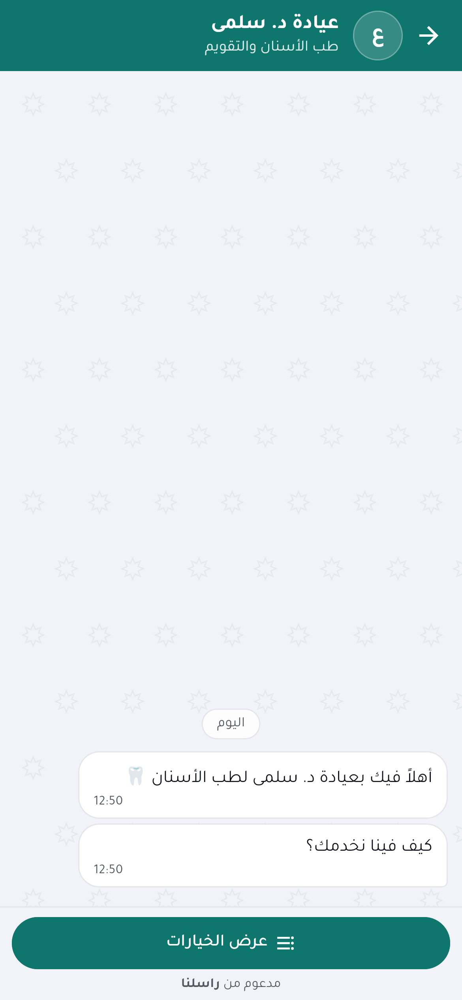
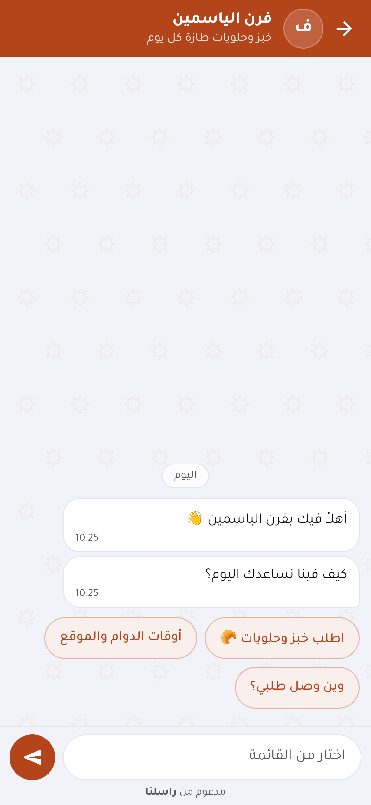
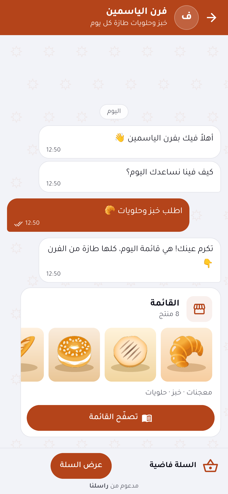
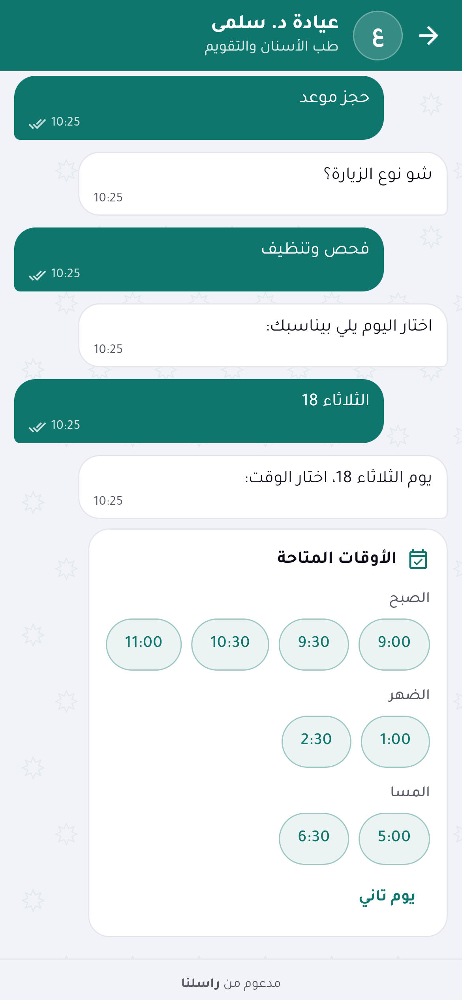
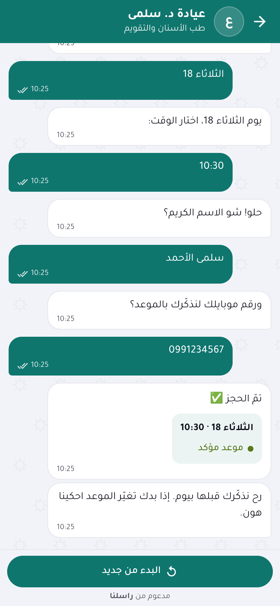
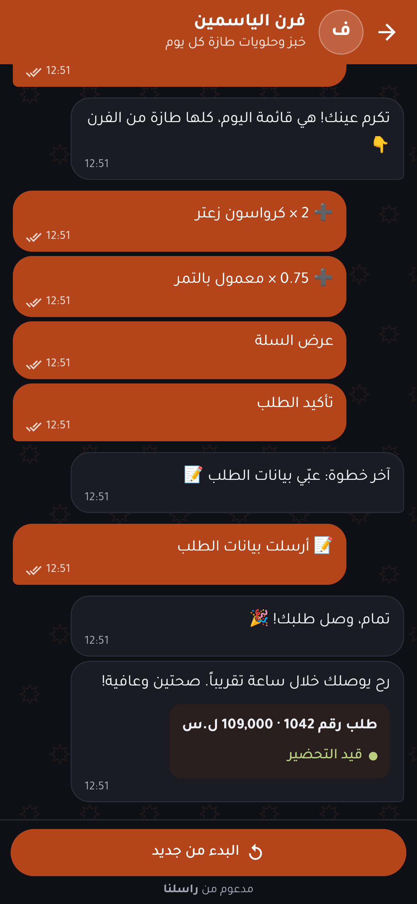

# raselna_chat

An Arabic-first chat for Flutter apps. You add your publishable key, and your app talks to the business's bot on [Raselna](https://raselna.com): orders, bookings, order tracking and support, in a chat your customers already know how to use.

> **Status: MVP (0.1.x).** Built against the Raselna chat API v1 contract (`https://api.raselna.com/v1`). The API is new, so details may still change before 1.0. You need a Raselna account for the server side: the business designs its bot in the Raselna dashboard, and this package only displays it. The public app API is rolling out now; until your business has an access key, run the example with its built-in mock (no network needed).

| Welcome | Quick replies | Continue in browser | Time slots | Booked | Dark |
| --- | --- | --- | --- | --- | --- |
|  |  |  |  |  |  |

## Setup in three lines

```yaml
# pubspec.yaml
dependencies:
  raselna_chat: ^0.1.0
```

Or straight from GitHub (before a release reaches pub.dev, or to try `main`):

```yaml
dependencies:
  raselna_chat:
    git:
      url: https://github.com/MahmoudSlameh/raselna_chat
      ref: main
```

Platforms: Android, iOS and web.

```dart
import 'package:raselna_chat/raselna_chat.dart';

await RaselnaChat.init(accessKey: 'rpk_live_…');   // once, e.g. in main()
RaselnaChat.open(context);                          // full screen
```

That's it. Other ways to show it:

```dart
RaselnaChat.open(context, asBottomSheet: true);    // a tall bottom sheet
const RaselnaChatView();                            // a widget anywhere (tab, page, card)
```

Optional settings:

```dart
await RaselnaChat.init(
  accessKey: 'rpk_live_…',
  appId: 'com.example.myapp',                       // your package / bundle id (X-Raselna-App), if the key is limited to apps
  baseUrl: Uri.parse('https://api.raselna.com/v1'), // default; fallback: https://app.raselna.com/api/v1
  locale: 'ar',                                     // 'ar' (RTL, default) or 'en'
  flow: 'support',                                  // a published flow the key allows; default = main
  source: 'home_banner',                            // where the chat was opened from (statistics)
  theme: const RaselnaChatTheme(radius: 14),        // overrides on top of the business colours
  themeMode: ThemeMode.system,                      // follows your app's Theme
);
```

## ⚠️ The access key is public. Never put a secret in an app.

`rpk_live_…` / `rpk_test_…` is a **publishable** key, like Stripe's publishable keys. Anyone can extract it from your APK or IPA, and that is fine: it only says "this is app X of business Y". The server limits what it can do (allowed flows, rate limits per key, device and IP, revocation and rotation from the dashboard).

- Do **not** put API tokens, the app's identity secret, or any other secret in your Flutter code. `RaselnaChat.init` refuses keys that look secret.
- Each install registers once and gets a **device credential**; that one *is* a secret, so it lives in Keychain / Keystore, is sent only as a header, and is never logged.
- Identified users (`RaselnaChat.setUser(jwt)`) are **not in API v1 yet**; the method is a stub that throws. When it lands, your **own server** will sign the user's token; the signing secret never goes in the app.
- Secret answers (passwords, PINs) are never typed into the app. Those steps open the business's secure web chat instead.

## What it shows

Everything the bot says and asks comes from the server; the SDK only renders it. No flow logic, variable names or graph details ever reach the app.

| Step from the server | In the app |
| --- | --- |
| Text, image, status card ("Order 1042 · being prepared") | Native bubbles |
| Menu with 1-3 options | Quick-reply chips under the bubble (typing the option number works too) |
| Menu with 4+ options | A button that opens a numbered bottom sheet |
| Text / number / phone / email / date input | The right keyboard, a quick local check, then the server's validation |
| Days and times (booking) | A slot picker card with grouped chips |
| Step n of m | A progress line over the input |
| End / paused | Start-over button / conversation number with copy and "continue" |
| Bot "typing" | Three-dot bubble and "typing…" in the header |
| Catalog, cart, multi-field form, secret input, any step this version doesn't know | A **"continue in browser"** card (below) |

### Continue in browser

Rich steps run on the business's own secure web chat for now. The card asks the API for a short-lived, single-use link, opens it in Custom Tabs / SFSafariViewController (never a WebView), and when the app comes back to the foreground the chat asks for the current question again and carries on natively. The device stays bound to the conversation the whole time, so nothing is lost. A step type added on the server after you shipped your app also lands here, so old app versions never break.

### Offline

A reply sent without a connection stays in a local queue, shown as "waiting to send", and goes out in order when the network is back (on resume, on a timer, or on a tap). `409 busy` and `429` retry on their own after the server's `Retry-After`. Each reply keeps one idempotency key for all its retries, so it is never applied twice. The queue never holds a secret, because secret steps never happen in the app.

### Accessibility

Each bubble is read as "who said what"; buttons have labels and 44-48 dp touch targets; text follows the system font size; the typing animation stops when the system asks for reduced motion; the business colour is adjusted on the device if it would fail 4.5:1 contrast.

## Theming

The API returns the business's palette (`primary`, `primary_fg`, `primary_strong`, `primary_tint`, `primary_dark`), already contrast-safe. Missing tones are derived on the device with the same rules. Override anything with `RaselnaChatTheme`:

```dart
RaselnaChatView(
  theme: RaselnaChatTheme(
    primary: Color(0xFF0F766E),
    fontFamily: 'MyAppFont', fontPackage: null,  // use your app's font instead of Tajawal
    showPattern: false,
  ),
)
```

Tajawal (SIL Open Font License 1.1) is bundled; see `fonts/OFL.txt`.

## Try it without an account

`MockTransport` plays two full conversations on the device, with no network:

```dart
await RaselnaChat.init(
  accessKey: 'rpk_test_demo',
  transport: MockTransport(scenario: MockScenario.bakery),  // or MockScenario.clinic
);
```

- **Bakery**: menu → catalog (continue in browser) → phone (with validation) → delivery or pickup → order confirmation; or track an order by number.
- **Clinic**: long menu (sheet) → service → day → time → name → phone → booking confirmation; or "talk to the receptionist", which pauses with a conversation number.

The `example/` app runs the mock by default and has a switch to use a real key. If the platform folders are missing, generate them once with `flutter create --platforms=android,ios,web .` inside `example/`.

## Your own UI (headless)

`RaselnaChatController` holds the lines, the current question and the queue, with no widgets. Build your own UI on it:

```dart
final c = RaselnaChat.controller;
await c.load();
c.entries;            // the lines on screen
c.prompt;             // MenuPrompt, InputPrompt, SlotsPrompt, HandoffPrompt, EndPrompt, …
await c.choose(option);
await c.sendText('0991234567');
```

## Dependencies

Every dependency can clash with your app's versions, so there are three:

| Package | Why |
| --- | --- |
| `http` | HTTPS calls to the API. The client is injectable (tests use `MockClient`). |
| `url_launcher` | Opens the one-time "continue in browser" link in the system browser engine. |
| `flutter_secure_storage` | The device credential is a secret (API contract), so it goes to Keychain / Keystore, with the offline queue. Prefer your own storage? Implement `RaselnaStore` (two methods) and pass it to `init(store: …)`. |

No state-management package, no Firebase, no WebView.

## API compatibility

| raselna_chat | Raselna chat API |
| --- | --- |
| 0.x (beta) | v1 |

Within v1 the server only adds. The SDK ignores unknown fields, skips unknown message types, opens unknown step kinds in the browser, treats unknown input types as text, and acts on unknown error codes by their HTTP status.

## Development

```bash
flutter analyze
dart format --set-exit-if-changed .
flutter test                     # unit, widget and transport tests
flutter test --update-goldens test/golden_test.dart   # regenerate the RTL goldens (Linux)
cd example && flutter build web && cd .. && node tool/capture.cjs   # screenshots + promo
```

## Releasing (maintainers)

Releases go to pub.dev from GitHub Actions (`.github/workflows/publish.yml`), with pub.dev's OIDC login, so no token is stored anywhere.

1. One time, on pub.dev: *raselna_chat › Admin › Automated publishing*: enable GitHub Actions, repository `MahmoudSlameh/raselna_chat`, tag pattern `v{{version}}` (and optionally require the `pub.dev` environment). The very first version must be published by hand (`flutter pub publish`) to create the package.
2. Bump `version` in `pubspec.yaml` and `raselnaSdkVersion` in `lib/src/version.dart`, add a `CHANGELOG.md` entry, and commit.
3. `git tag v0.1.1 && git push origin v0.1.1`. The workflow checks that the tag matches the pubspec version, runs analyze, format and tests, then publishes.

## License

MIT © Raselna. The bundled Tajawal font is under the SIL Open Font License 1.1.

---

<div dir="rtl">

## بالعربي

**raselna_chat** باكج Flutter بتعطي تطبيقك شات عربي جاهز مع بوت الشركة على [راسلنا](https://raselna.com): طلبات، حجوزات، تتبّع طلب، ودعم. بتحط المفتاح العام وبتفتح الشات بسطرين:

</div>

```dart
await RaselnaChat.init(accessKey: 'rpk_live_…');
RaselnaChat.open(context);
```

<div dir="rtl">

- **نسخة أولى (MVP):** الواجهة والمحادثات الوهمية شغّالة، والـAPI العام (v1) عم يتثبّت، فممكن يتغيّر شي قبل 1.0.
- **بدك حساب براسلنا:** الشركة بتصمم البوت من لوحة راسلنا، والباكج بتعرضه بس.
- **المفتاح عام، مو سر:** `rpk_live_…` بينقرا من أي APK، وهاد طبيعي. **لا تحط أي سر بالتطبيق** (توكنات، سر الهوية…). بيانات الجهاز (device credential) بتنحفظ بـKeychain/Keystore. الإجابات السرية (كلمة سر، PIN) ما بتنكتب بالتطبيق أبداً، بتنفتح بصفحة آمنة.
- **عربي أولاً:** من اليمين لليسار، خط Tajawal مضمّن، ونصوص إنكليزية كمان.
- **أصلي:** فقاعات، أزرار رد سريع، قائمة خيارات، إدخال رقم/هاتف/إيميل مع تحقق، اختيار مواعيد، بطاقات الحالة والنهاية والإيقاف، ومؤشر «يكتب…».
- **«كمّل بالمتصفح»:** الكتالوج والسلة والفورم بيفتحوا بصفحة الشركة الآمنة، وبس ترجع للتطبيق الشات بيكمّل.
- **بلا إنترنت:** الرسالة بتستنى بطابور وبتنبعت لحالها لما يرجع النت، وما بتتنفذ مرتين.
- **جرّب بلا حساب:** `MockTransport` فيه محادثة مخبز ومحادثة عيادة كاملين.
- **ترخيص MIT.**

</div>
